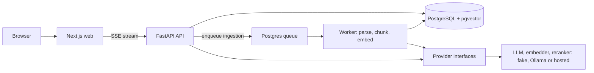

# Book RAG

Ask questions about Vietnamese books and get answers with citations to the section and page.

> Work in progress. This is the rebuild of a [university project](https://github.com/phuchaitt3/book-rag) (v1).

## Goals and priorities

This is a portfolio project built to show production-grade engineering, so **scalability and operability come before features**. These are design targets, and much of this is not built yet. When two choices conflict, the order is:

1. **Scales without redesign:** target a stateless API behind autoscaling compute, pooled database connections, an index strategy for vector search, and slow work (ingestion) kept off the request path.
2. **Measured, not assumed:** target answer quality tracked with an evaluation set in CI, and performance claims backed by numbers.
3. **Reproducible:** one command runs it locally, pre-commit runs the same lint and type checks as CI (CI also runs tests and builds), and deploy configuration is to live in git.
4. **Portable:** plain Postgres and containers, so no single vendor is required. Vendor-specific tooling is adopted only when it earns its place.
5. **Features** follow, in small reviewed pull requests.

## Learning goal

This project is also how its author is learning system design. Each architecture choice is written up as an [architecture decision record](docs/adr/README.md): the options, the trade-offs, the reasoning, and what would change at 1000x the load. The process is in [docs/design](docs/design/README.md).

## Stack

| Layer | Tech |
|---|---|
| Web | Next.js 16 (App Router), TypeScript, Tailwind CSS |
| API | FastAPI, Pydantic settings, SQLAlchemy 2 (async) |
| Data | PostgreSQL + pgvector |
| Tooling | uv workspace, pnpm workspace, ruff, mypy (strict), pytest, GitHub Actions |

## Layout

```
apps/web        Next.js frontend
apps/api        FastAPI backend
packages/rag    RAG core (pure Python, unit-tested)
infra/          database init and deploy configs
```

## Architecture

Target design; see [Status](#status) for what exists today. Decisions behind it: [docs/adr/](docs/adr/).



An answer is built from hybrid retrieval (vector search plus Postgres full-text search), a rerank step, and a streamed LLM reply that cites book, section and page. Every model sits behind an interface, so local, test and production runs differ only in configuration.

## Status

| Area | State |
|---|---|
| Skeleton: monorepo, Docker Compose, health checks, CI, pre-commit | done |
| Provider interfaces (LLM, embedder) with fake and Ollama providers | done |
| Database schema and first migration | in review |
| Upload, PDF parsing and chunking, ingestion worker | planned |
| Hybrid retrieval and streamed, cited answers | planned |
| Evaluation set and CI eval job | planned |
| Authentication, per-user libraries, hosted demo | planned |

The milestone plan and open work are tracked in this repository's pull requests and issues.

## Run locally

Requires Docker and pnpm. [uv](https://docs.astral.sh/uv/) is needed only for the checks below.

```sh
pnpm stack:up      # Postgres + pgvector, API on :8000, web on :3000 (all in Docker)
pnpm stack:down    # stop and remove everything (data is kept in the db-data volume)
pnpm stack:dev     # same as up, in the foreground with hot reload (docker compose watch)
```

The home page shows whether the API is reachable. `GET /healthz` is liveness; `GET /readyz` also checks the database.

## Checks

```sh
uv sync
uv run ruff check . && uv run ruff format --check . && uv run mypy && uv run pytest
pnpm lint:web && pnpm typecheck:web && pnpm build:web
```

### Pre-commit

The same checks run on every commit (ruff, ruff format, mypy, and web lint and typecheck when `apps/web` changes), and CI runs them on all files.

```sh
uv tool install pre-commit
pre-commit install
pre-commit run --all-files    # run by hand
```

## Configuration

Settings are read from environment variables. Copy [.env.example](.env.example) to `.env` (git-ignored) to override the defaults; the Docker Compose stack works without it.

| Variable | Default | Meaning |
|---|---|---|
| `ENVIRONMENT` | `development` | Runtime environment name |
| `DATABASE_URL` | local Compose Postgres (`postgresql+asyncpg://...`) | Async SQLAlchemy connection URL |
| `CORS_ORIGINS` | `["http://localhost:3000"]` | Origins allowed to call the API (JSON list) |
| `NEXT_PUBLIC_API_URL` | `http://localhost:8000` | API address the web app calls (set in `apps/web/.env.local`) |

Never commit `.env` files or keys.

## Contributing and documentation

- [CONTRIBUTING.md](CONTRIBUTING.md): workflow, checks and branch naming
- [docs/adr/](docs/adr/): architecture decision records
- [SECURITY.md](SECURITY.md): reporting a vulnerability

## License

[MIT](LICENSE)
